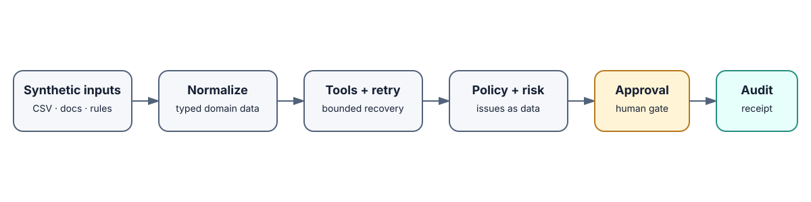
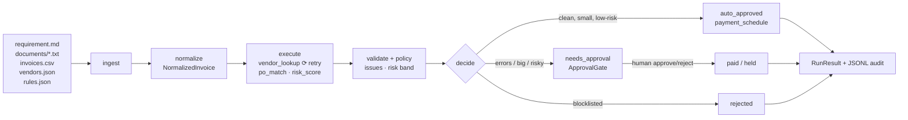

# FDE Implementation Workbench

**Messy customer requirement → reliable, approval-gated workflow — with receipts.**

A Forward-Deployed / implementation-engineering workbench that visibly transforms
a sloppy synthetic customer ask (emails, CSV extract, flaky APIs) into **normalized
configuration → validated decisions → bounded retries → human approval → full audit
trail**. Runs 100% offline on the standard library — no model keys, no network, no
install step beyond Python 3.10+.

**Status:** public, offline V1 reference implementation. All fixtures and adapters
are synthetic; this repository contains no customer data or production credentials.

## The problem

Enterprise pilots die in the gap between "the demo worked" and "audit will sign
off on it". This repo shows the unglamorous engineering that closes that gap:
tolerant ingestion, explicit business rules, structured tool calls with bounded
recovery, a human checkpoint that can't be bypassed, and an append-only audit log.

## What was built

- **8-stage pipeline** (`src/workbench/`): ingest → normalize → execute (tool
  calls) → validate → policy → risk → approval gate → finalize/audit.
- **4 mock tool adapters** behind one `Tool` protocol (`vendor_lookup`,
  `po_match`, `risk_score`, `payment_schedule`) with distinct retryable vs fatal
  failures and deterministic failure injection.
- **Configurable business rules** (`fixtures/rules.json`): auto-approve limit,
  currency allowlist, PO-match tolerance, vendor blocklist, risk threshold.
- **Bounded retry/recovery** (attempt counts recorded on every `ToolCall`),
  **approval gate** (escalated items can never self-pay), **JSONL audit trail**.
- **Two surfaces**: CLI (`demo/run/approve/pending/list-scenarios/serve`) and a
  stdlib-only local HTTP API (`/health`, `/scenarios`, `/runs`, `/runs/{id}/approve`).
- **15 tests**: happy path, retry recovery/exhaustion, fatal-no-retry,
  escalation, blocklist rejection, configurable-policy, API round-trip.
- **Extensible**: new customer scenario = new fixture dir + one registry line
  (see `docs/ARCHITECTURE.md`).

## Why it's non-trivial

- Messy inputs are handled **as data, not exceptions** — `"$1,200.00"`,
  lowercase vendors/currencies, missing POs all parse with notes and route
  correctly instead of crashing the run.
- The error taxonomy matters: warnings (duplicates) vs escalating errors
  (PO mismatch) vs unapprovable rejections (blocklist) vs retryable
  (transient timeout) vs fatal (rail limit) — five distinct paths, all tested.
- The approval gate is a **hard invariant**, not UI: `needs_approval` decisions
  cannot reach `payment_schedule` without an explicit identity + reason.

## Quickstart (60 seconds)

```bash
git clone <this-repo> && cd fde-implementation-workbench

# 1. End-to-end demo (offline, deterministic)
PYTHONPATH=src python3 -m workbench demo

# 2. Full test suite
./scripts/test.sh

# 3. Local API
./scripts/serve.sh   # -> http://127.0.0.1:8765
```

Optional: `cp .env.example .env` to tweak scenario, audit dir, port, and
failure-injection knobs. No secrets exist or are needed.

## Recruiter demo deployment

The repository includes a Vercel-ready, browser-based demo at `index.html` and
three small Python functions under `api/`. Import the repository into Vercel
with the root directory left unchanged; no environment variables or database
are required.

- `POST /api/run` recreates the real synthetic fixture pipeline for every demo
  run.
- `POST /api/approve` recreates that deterministic run, applies the existing
  `ApprovalGate`, and returns the resulting audit receipt.
- The UI deliberately labels itself a **Demo session**: its visible state lives
  only in the browser and resets on refresh. This is honest serverless behavior,
  not a claim of durable customer-data storage.

For a local visual demo, run `./scripts/serve.sh` for the original API or serve
the repository root with any static server plus the Vercel functions emulator.
The core workflow itself remains fully offline and reproducible with the
Quickstart commands above.

## Example output (real, abridged — run id varies per run)

```
========================================================================
FDE WORKBENCH — END-TO-END DEMO (synthetic, offline, deterministic)
========================================================================
run run-cde7206b  scenario=vendor_payments_v1
invoices=6  paid_total=$4,700.00
decisions: needs_approval=2, paid=3, rejected=1
------------------------------------------------------------------------
[PAID     ] INV-1001  Northwind Traders  $1,200.00 USD  PO=PO-501  risk=30
           -> clean, within limits, low risk | PAY-INV-1001
           tool: vendor_lookup x1 [ok]
           tool: po_match x1 [ok]
           tool: risk_score x1 [ok]
           tool: payment_schedule x1 [ok]
           WARNING: W_DUPLICATE — duplicate amount 1200.00 for vendor V-NORTHWIND
           WARNING: W_PARSE_NOTE — amount normalized '$1,200.00' -> 1200.00
[REJECTED ] INV-1002  Globex Corp  $18,500.00 USD  PO=PO-502  risk=100
           -> blocked vendor — rejected without approval option
           ...
           ERROR: E_VENDOR_BLOCKED — vendor V-GLOBEX is blocklisted
[ESCALATED] INV-1003  Initech LLC  $4,800.00 USD  PO=PO-503  risk=25
           -> 1 error(s) require human review: E_PO_MISMATCH
[ESCALATED] INV-1004  Umbrella Supply  $3,200.00 EUR  PO=-  risk=35
           -> 2 error(s) require human review: E_PO_MISSING, E_CURRENCY_BLOCKED
[PAID     ] INV-1005  northwind traders  $1,200.00 USD  PO=PO-501  risk=30
           -> clean, within limits, low risk | PAY-INV-1005
           ... (duplicate + casing warnings, still payable)
[PAID     ] INV-1006  Hooli Industrial  $2,300.00 USD  PO=PO-506  risk=5
           -> clean, within limits, low risk | PAY-INV-1006
           tool: vendor_lookup x2 [retrying] :: recovered after 1 retry(ies): transient vendor-master timeout for V-HOOLI
           ...
------------------------------------------------------------------------
approval queue: INV-1003, INV-1004
rejected: INV-1002
audit events: 17
```

Every invoice exercises a different path: clean pay, blocklist reject, PO-drift
escalation, uncertain-case escalation (EUR + no PO), duplicate-with-warnings,
and retry-then-recover.

## Architecture





## Project structure

```
src/workbench/      models, ingest, normalize, tools, retry, validate,
                    approval, audit, workflow, scenarios, config, cli,
                    render, server
fixtures/           requirement.md, documents/, invoices.csv, vendors.json, rules.json
tests/              test_pipeline.py (happy path), test_failure_paths.py,
                    test_server.py (API)
docs/               ARCHITECTURE.md, DEMO.md
scripts/            demo.sh, test.sh, serve.sh
```

## Design decisions (short)

- Stdlib-only: deployable into locked-down customer environments; zero supply-chain risk.
- Deterministic: failure injection is explicit (`WORKBENCH_FLAKY_VENDOR_FAILS`),
  so retries are testable without mocks-of-mocks.
- Issues-as-data: the run always completes with a decision per invoice — the
  demo's value is the escalation paths, not the happy path.

## Limitations

- Vendor/PO "APIs" are in-memory mocks over `vendors.json` (by design — offline).
- Risk scoring is rules-based, not a trained model; swap in `RiskScoreTool`.
- Single-process run store for the HTTP API (in-memory dict); persist via the JSONL audit files for anything durable.
- No auth on the local API — it's a localhost demo surface, not a product endpoint.

## Recruiter lens

This is intentionally FDE-shaped engineering: translate an ambiguous requirement
into configuration, integrate imperfect inputs, encode business rules, recover from
tool failures, and leave an auditable decision that a human can approve. It is a
portfolio implementation exercise, not a claim of FDE employment or customer
deployment.

## Roadmap

- [ ] Second scenario (e.g. refund triage) to prove the registry pattern
- [ ] SQLite-backed run store + audit query CLI
- [ ] Policy-as-code diff (`rules.json` v1 → v2 impact preview)
- [ ] Optional LLM normalizer behind the same `Tool` protocol (flag-gated, offline default kept)

## License

MIT — see [`LICENSE`](LICENSE).
