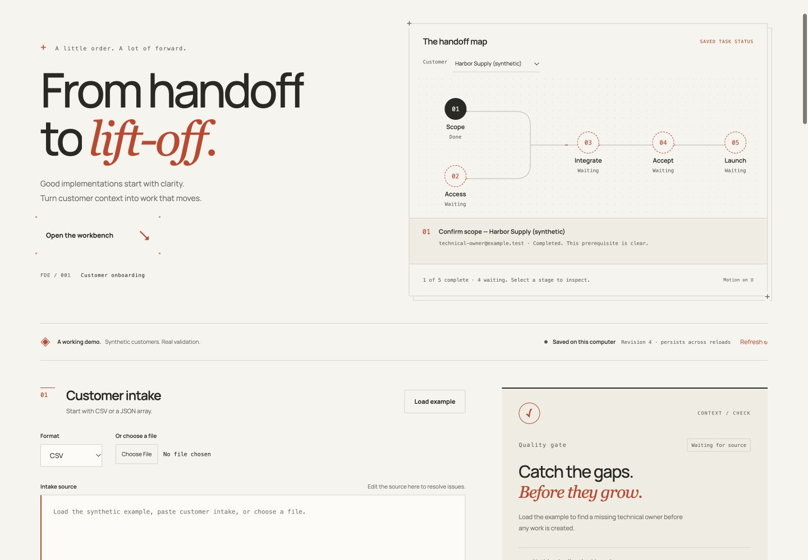
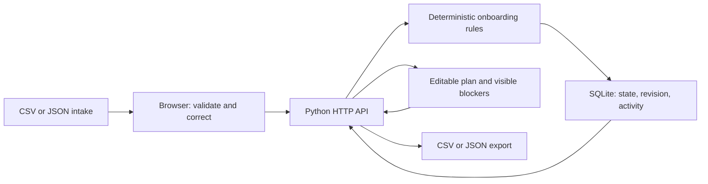

# FDE Implementation Workbench

A local tool for an implementation specialist turning incomplete customer intake into an owned, reviewable launch plan. Import a synthetic customer's CSV or JSON, fix field-level errors, generate a checklist, resolve dependencies, and export the plan.

The example is an invented AI software company onboarding an invented business customer. It starts with a missing technical owner and a sandbox-access blocker, so the demo shows the failure and correction as well as the happy path. No real customer data, external services, credentials, or model API are required.

## Interface

A warm editorial workspace with a live handoff map, customer-specific stage inspection, a task ledger, and keyboard-friendly editing. The map reflects saved state; it does not execute integrations. Motion can be paused and respects the device's reduced-motion setting.



[Design, motion, and verification notes](docs/UI_DESIGN.md) · [Third-party licenses and pinned sources](THIRD_PARTY.md)

## Start here

From the repository root, with Python 3.10 or newer:

```bash
python3 -m venv .venv
source .venv/bin/activate
PYTHONPATH=src python -m unittest discover -s tests -v
WORKBENCH_DB="$PWD/var/onboarding.sqlite3" PYTHONPATH=src python -m workbench serve --port 8765
```

Open **http://127.0.0.1:8765/**. Stop the server with Ctrl-C. There are no runtime packages to install; the backend uses Python's standard library. The vanilla JavaScript frontend includes a locally vendored Motion animation library and Manrope font; no CDN connection or frontend build is needed. Run these commands in a second terminal to check syntax and replay the original invoice demo:

```bash
source .venv/bin/activate
python -m compileall -q src tests
PYTHONPATH=src python -m workbench demo
```

For a separate demo database, set `WORKBENCH_DB` to another local file before starting the server. Reusing the same file keeps the onboarding plan across reloads and server restarts.

## Verified results

The October 14, 2026 local verification passed **50 Python tests**, up from the **15-test baseline**. The source-run commands also passed in a clean temporary virtual environment with Python **3.14.7**, no third-party packages, and no warnings.

Separately, **15 real-browser smoke checks passed**: incomplete CSV intake and correction, five-task generation, rejected dependency transitions, sibling draft preservation, all five tasks completed in order, duplicate no-op, explicit conflict, reload with 11 activity entries, actual JSON/CSV downloads, a 390 px screen without horizontal overflow, tablet Refresh visibility, literal HTML/script rendering, offline feedback, and no captured uncaught errors. The [optional browser script](scripts/browser_smoke.js) is separate from the Python suite; [run instructions](docs/ONBOARDING_DEMO.md#optional-browser-regression) require an already installed Ego Browser CLI.

The subsequent frontend redesign reran all **50 Python tests** and recorded **19 browser checks** across animation controls, map navigation, customer selection, and 320/390/900/1440 px layouts, plus manual CSV/JSON correction, task editing, persistence, and download flows. These checks are separate from the earlier smoke run above. See [UI design notes](docs/UI_DESIGN.md).

## What the onboarding workflow does

- **Import and validate:** CSV and JSON share a documented seven-field [intake schema](docs/INTAKE_SCHEMA.md). Required fields, owner addresses, row shape, unknown fields, malformed data, duplicates, and conflicting customer IDs produce explicit issues.
- **Correct before creating:** an invalid import creates nothing. The source remains available to edit. Reimporting the same customer creates no duplicate tasks; conflicting changes require an explicit correction rather than an overwrite.
- **Plan and edit:** valid intake generates five tasks with owners, statuses, dependencies, blockers, and launch acceptance criteria. Task titles, owners, statuses, and blockers are editable.
- **Enforce dependencies:** server-side rules reject unsupported transitions and explain unmet prerequisites. Completing a task requires starting it first and clearing its blockers.
- **Save and inspect:** a local SQLite file stores state atomically. Revision checks reject stale edits. Timestamped activity describes imports and changes; it is a local demo log, not a secure audit trail.
- **Export:** CSV and JSON contain the task plan, including dependency IDs. CSV prefixes every data cell with an apostrophe to keep spreadsheet formulas as text; the documented plan parser removes that transport prefix losslessly. These are plan exports, not intake files.

Follow the [reproducible walkthrough and two-minute demo](docs/ONBOARDING_DEMO.md). Read the [architecture](docs/ONBOARDING_ARCHITECTURE.md) and [interview guide](docs/INTERVIEW_GUIDE.md) for the code paths, tradeoffs, and defensible talking points.

## What changed in this version

The repository already contained a synthetic invoice-processing CLI and HTTP API, mock vendor/PO/risk/payment adapters, retry logic, human approval, JSONL event logging, a browser invoice demo with serverless wrappers, and 15 passing baseline tests. The original invoice walkthrough remains in [docs/DEMO.md](docs/DEMO.md).

This version adds the customer-onboarding domain, browser interface, SQLite persistence, strict request handling, portable plan export, and regression coverage. The existing invoice browser demo uses root `index.html`, `api/`, and `vercel.json`. The new onboarding UI is served from `src/workbench/static/` by the local Python server; it is not integrated into that separate serverless demo or deployed. The invoice scenario and onboarding plan are separate workflows. Invoice API run objects remain in memory; onboarding state uses SQLite. The mock invoice demo does not move real money.

## How it fits together



| Location | Purpose |
|---|---|
| `src/workbench/onboarding.py` | Intake rules, task generation, transition checks, plan serialization |
| `src/workbench/onboarding_store.py` | Transactional SQLite storage and revision conflicts |
| `src/workbench/server.py` | Local HTTP routes, request validation, static assets, error responses |
| `src/workbench/static/` | HTML, CSS, and JavaScript interface; imported strings rendered as text |
| `fixtures/onboarding/` | Synthetic incomplete and valid customer examples |
| `tests/` | Python domain, persistence, HTTP, and original invoice tests |
| `scripts/browser_smoke.js` | Optional real-browser workflow and safe-rendering regression |

## Scope and limitations

This is an AI-assisted portfolio implementation exercise with a real local HTTP backend and deterministic business rules. It demonstrates a small end-to-end workflow; it does not establish production deployment, customer adoption, or operational savings.

The server binds to loopback and has no authentication, roles, encryption-at-rest policy, backups, or tamper-evident activity history. SQLite stores the whole onboarding state as one document, which keeps the slice small but is unsuitable for large multi-user workloads without further design. Same-origin checks and safe text rendering reduce specific demo risks; they are not a security audit. The checklist records a human's status updates and does not provision an integration or verify that a customer accepted a launch.

No AI inference is needed at runtime. Before using résumé claims or presenting the project, work through the [interview guide](docs/INTERVIEW_GUIDE.md) and reproduce the demo yourself.

Publication status at this handoff: the onboarding changes are local and have not been published. The [existing public repository](https://github.com/zayyanla-hash/fde-implementation-workbench) contains the earlier baseline; that URL does not yet expose this new work.
