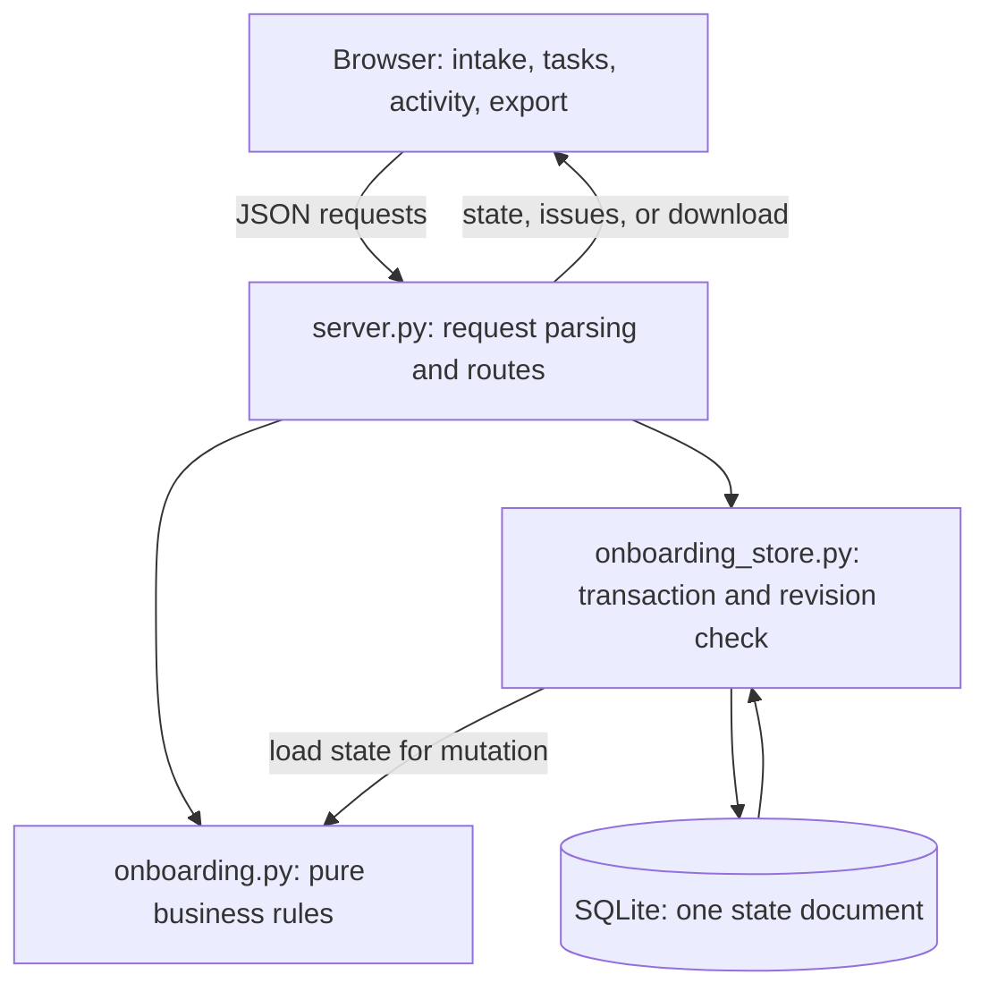

# Customer onboarding architecture

This is a local Python HTTP backend with a SQLite database and a plain HTML/CSS/JavaScript frontend. It adds an onboarding workflow beside the repository's existing invoice pipeline. It does not depend on an LLM, live integration, or cloud service.

## Request and state flow

1. The browser loads the known static assets from `src/workbench/static/`.
2. Preview sends the original text and selected format to the HTTP API. `parse_intake` returns validated records and row/field issues without saving anything.
3. Import reruns validation, checks the client's revision, generates tasks, and saves the complete state in a SQLite transaction. A validation error leaves stored data unchanged.
4. An edit sends the task ID, allowed changes, and loaded revision. The domain layer checks field types and dependency invariants before storage commits a new revision.
5. Reads return the saved plan and computed blocker explanations. The browser shows those explanations alongside the editable tasks.
6. Export serializes the saved task plan as CSV or JSON. Dependencies remain explicit IDs in either format. CSV uses the spreadsheet-safe transport described below.

## Responsibilities

| Layer | What it owns | What it does not prove |
|---|---|---|
| `static/index.html`, `app.js`, `styles.css` | Intake correction, task editing, readable feedback, downloads; safe DOM text rendering | Browser validation alone cannot enforce workflow rules |
| `server.py` | Local routes, strict object requests, bounded bodies, field/type checks, domain errors mapped to HTTP responses | Authentication, production serving, or authorization |
| `onboarding.py` | Required fields, duplicate/conflict policy, deterministic five-task generation, allowed transitions, export/parse round-trip | A real integration ran or acceptance criteria passed |
| `onboarding_store.py` | Atomic state writes and optimistic concurrency using a revision number | High-throughput collaboration or a tamper-resistant log |
| `fixtures/onboarding/` | Invented AI-company/customer intake, including missing technical owner and sandbox dependency | Actual customer usage |

The pure import and update functions receive the current time as an argument. This makes activity timestamps controllable in tests and keeps parsing, task generation, and transition decisions deterministic.

## Export transport

JSON exports an envelope containing `schema_version: 1` and the full `tasks` array. CSV contains the same task fields and represents `depends_on` as a JSON-array string. Every CSV data cell has one leading apostrophe so a spreadsheet treats values such as `=SUM(...)` as text. This is a documented transport encoding: a generic CSV reader sees the apostrophe, while this project's `parse_plan` removes exactly that prefix and restores the original value, including values that already began with an apostrophe.

`parse_plan` is an independently tested Python export reader, not a browser import feature. The browser intake importer accepts customer records, not exported task plans. JSON is the clearest choice for consumers wanting unencoded task values.

## Intake and duplicate policy

The [schema](INTAKE_SCHEMA.md) requires `customer_id`, `customer_name`, `integration`, `technical_owner`, `data_access_owner`, `launch_owner`, and `acceptance_criteria`. Owner values must be email-shaped strings. Fixtures use `example.test` addresses.

Parsing reports issues with a row, field, severity, code, and readable message. Unknown fields, malformed structures, and missing values are errors rather than silently discarded input. A batch containing an error is rejected as a whole. Identical customer IDs with identical data are warnings and do not generate extra tasks. Reusing an existing ID with changed data is a conflict; this version has no implicit customer-update operation.

## Dependency invariant

Each imported customer gets scope, data-access, integration, acceptance, and launch tasks. The data-access task starts blocked because sandbox access has not been granted. Integration requires completed scope and data-access tasks; acceptance requires integration; launch requires acceptance. The task graph is generated by the domain layer rather than edited in the browser.

A task can only become active or complete when its dependencies are done. Completion also requires an `in_progress` step and no explicit blocker. Blocking a task requires a reason. Reopening a prerequisite is rejected if it would invalidate an active or completed descendant. Both the explicit blocker and unmet dependency names are returned as explanations.

This places the invariant on the server: a direct HTTP request cannot bypass a disabled button or client-side check.

## Persistence and concurrency

`WORKBENCH_DB` selects the database path; the default is `./var/onboarding.sqlite3` relative to the process working directory. The state contains `schema_version`, `revision`, `customers`, `tasks`, and `activity`. SQLite stores that state as one JSON document.

A mutation uses `BEGIN IMMEDIATE` and checks the submitted revision inside the transaction. A stale revision returns HTTP 409, preserving the newer data. Invalid changes fail before commit. A duplicate-only import makes no new tasks and does not advance the revision. A corrupt existing database is reported instead of silently reset.

Whole-state storage was chosen over a new ORM and normalized relational schema to keep this local vertical slice inspectable within the existing standard-library stack. The tradeoff is write amplification, growing document size, and no fine-grained concurrent editing. A shared product would need a migration strategy, normalized records, authorization, backup/recovery, and explicit conflict resolution.

## HTTP surface

| Method and path | Purpose |
|---|---|
| `GET /` | Browser app |
| `GET /api/onboarding` | Saved state plus computed task blocker explanations |
| `POST /api/onboarding/preview` | Parse source; return records and issues without saving |
| `POST /api/onboarding/import` | Validate and create a plan; duplicate-only imports are a no-op |
| `PATCH /api/onboarding/tasks/{id}` | Validate and save allowed task changes |
| `GET /api/onboarding/export?format=json` | Download portable task JSON |
| `GET /api/onboarding/export?format=csv` | Download portable task CSV |
| `GET /api/onboarding/example?format=csv&invalid=1` | Load the incomplete synthetic example |

Malformed HTTP request JSON receives 400; invalid request fields/types receive 422; stale revisions and forbidden transitions receive 409; missing tasks receive 404. Preview returns 200 with structured issues even when the intake text is malformed; importing invalid intake returns 422 and changes nothing. JSON bodies require `Content-Type: application/json` and are capped at 1 MiB. Error bodies include a readable error and, where applicable, structured issues. The original invoice API now also rejects malformed request JSON rather than silently starting a default run.

## Relationship to the existing invoice workflow

`workflow.py`, `normalize.py`, `validate.py`, `tools.py`, `retry.py`, `approval.py`, and `audit.py` implement the original synthetic invoice scenario. Its routes remain `/health`, `/scenarios`, `/runs`, `/runs/{id}`, `/runs/{id}/approve`, and `/runs/{id}/audit`. The CLI still runs it with `PYTHONPATH=src python -m workbench demo`.

The public baseline also contains an invoice browser demo in root `index.html`, with serverless handlers under `api/` and `vercel.json`. Those files are retained from public revision `7c14198`; this change does not deploy or add onboarding to that separate surface. The onboarding UI is served by the local Python server from `src/workbench/static/`.

Onboarding does not reuse payment approval or pretend to be a new invoice adapter. It shares the local HTTP server and standard-library approach, while keeping its own domain rules and SQLite state. Invoice run objects remain process-local. Existing JSONL invoice logs and the onboarding activity list are ordinary editable local files, not secure audit evidence.

## Security and operational boundary

Imported customer strings are rendered through DOM text APIs so embedded markup appears as text. Requests are constrained to the demo's known routes and supported input types; local Host checks, same-origin mutation controls, and a static Content Security Policy protect specific local-browser boundaries. These checks do not constitute penetration testing or prove the app secure.

There is no login, role model, production deployment, encrypted storage, scheduled backup, external monitoring, real sandbox provisioning, or trusted acceptance check. The app is intended for synthetic local data and a bounded, explainable demonstration.
