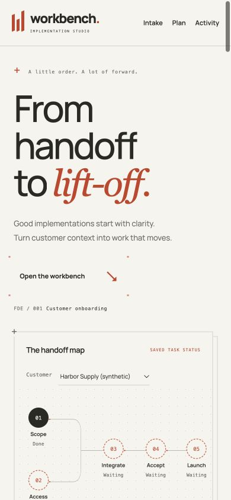

# Workbench interface redesign

The interface is an editorial instrument panel: warm paper, charcoal text, vermilion annotations, local Manrope typography, and a contrasting italic serif headline. Numbered chapters and thin rules replace the earlier rounded dashboard cards. The task view is a ledger with owners, prerequisites, and blockers aligned in columns on desktop and stacked on phones.

## References and what was used

- [Teenage Engineering TX–6](https://teenage.engineering/products/tx-6): precise instrument markings and readable functional groupings inspired the map and chapter numbers. No imagery or source was copied.
- [Linear's UI redesign](https://linear.app/now/how-we-redesigned-the-linear-ui): hierarchy, alignment, and reduction of visual noise informed the task ledger.
- [Vengeance Corner Button](https://www.vengenceui.com/components/corner-button): an MIT-licensed corner-frame pattern adapted for the main intake link, including keyboard focus.
- [Vengeance Stagger Text](https://www.vengenceui.com/components/stagger-text): its MIT-licensed word-mask reveal adapted to the headline. Screen readers get one intact heading.
- [Motion](https://motion.dev/docs/quick-start): the free MIT browser library powers the spring and SVG animations; version 14.2.0 is served locally.
- [Skiper UI](https://skiper-ui.com/) and [Animmaster Lib](https://animmasterlib.dev/): reviewed for interaction references. Skiper mixes free and premium components; Animmaster markets paid packs. Neither is installed or copied.

See [third-party notices](../THIRD_PARTY.md) for licenses and source provenance.

## Functional motion

1. The headline reveals by word through masks, with a staggered easing curve.
2. The dependency path draws on entrance; small moving dashes illustrate its direction, not background task execution.
3. Stage markers respond with spring motion on hover and keyboard focus.
4. The inspector shows the current customer's task title, owner, and actual blocking reasons. Clicking a stage scrolls to and focuses its task.
5. Changed metrics settle into place after a real saved state change; there are no fabricated live counters.
6. Main actions have corner-frame, hover, and press feedback. Section headings enter once as they appear.
7. Motion controls stop animation and smooth page scrolling. Resuming does not hide the page or replay its entrance. Device reduced-motion preferences take precedence.

All animated styles progressively enhance visible HTML. Missing Motion does not prevent intake, editing, or exports. The UI uses safe text rendering for imported content. Form drafts remain keyed by task ID; saving restores keyboard focus to the saved task's button.

## Verification

- Existing Python suite: **50 passed**, with no domain or storage changes in this redesign.
- **19 recorded browser assertions** during the redesign: stage focus, pause/resume, system reduced motion, multi-customer selection, duplicate no-op, selection preservation, actual blocker text, local font/style availability, console cleanliness, and responsive layout checks.
- Viewports: **320, 390, 900, and 1440 px** without horizontal overflow, with intake using available width.
- Manual browser flows: missing-owner CSV validation and correction; creation of five tasks; blocked integration rejection; sibling draft retention through save/refresh; scope start and completion; reload; second customer via JSON.
- Actual JSON and CSV downloads each parsed to the same **10 tasks** in the two-customer QA database.
- JavaScript syntax and Git whitespace checks passed. Six local assets returned 200 with expected content types.
- Rendered desktop and mobile screenshots were inspected. No captured console warnings/errors in the final browser session.

These checks do not establish production readiness, complete accessibility conformance, or real customer outcomes. The original invoice browser/serverless surface is unchanged. No deployment or GitHub push was performed.

## Reproduce

Use the [README run commands](../README.md#start-here). Load an example, validate and correct the missing owner, then create a plan. Hover or tab through the map to inspect stages. Try starting integration before its prerequisites; then start and finish scope to see the map change. Use the Motion control and your system's reduced-motion setting. Resize to phone width and download both formats.

